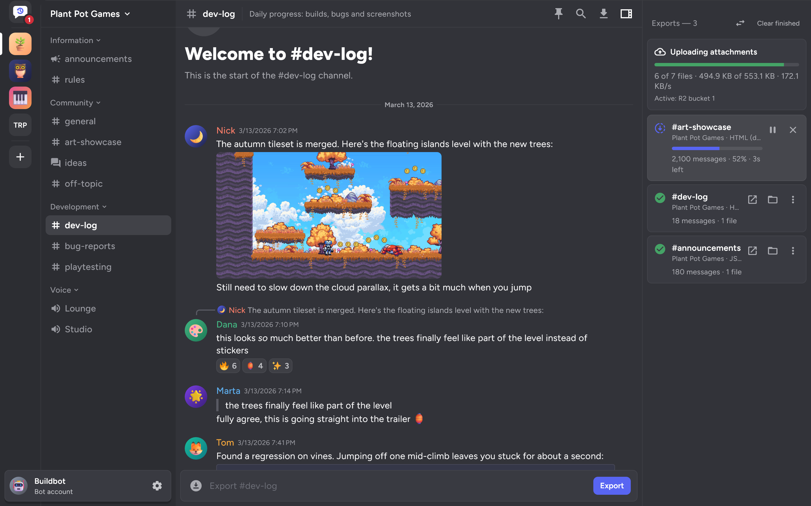
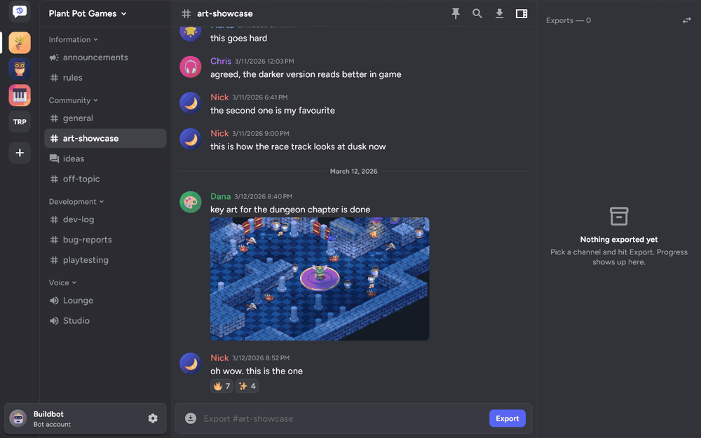
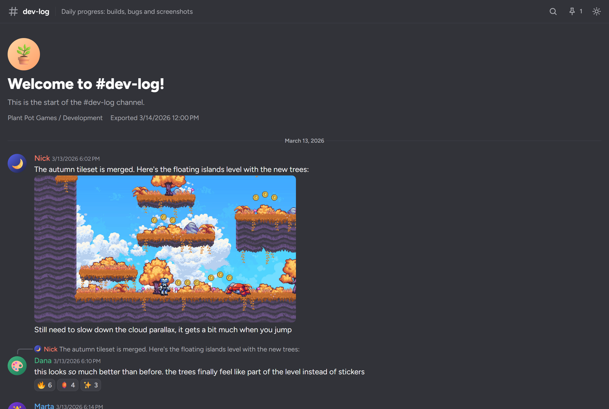
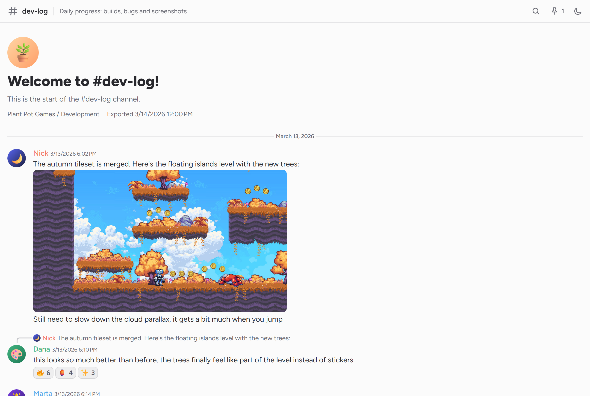
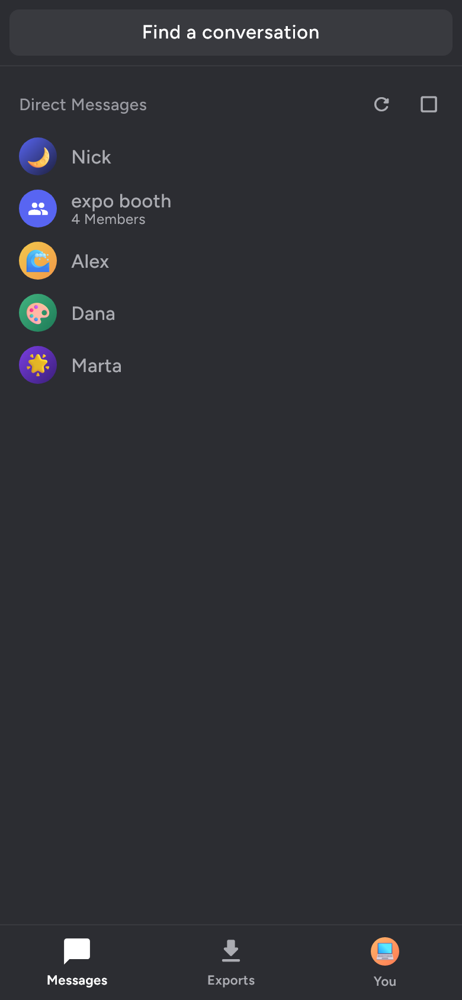
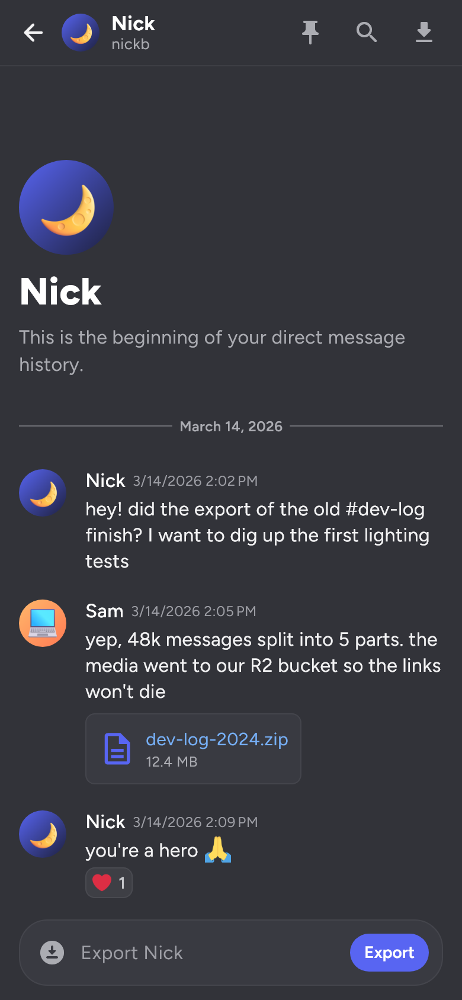
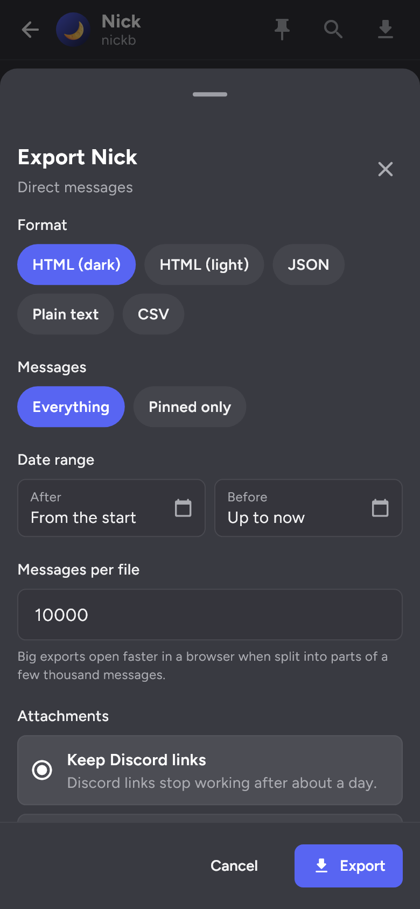
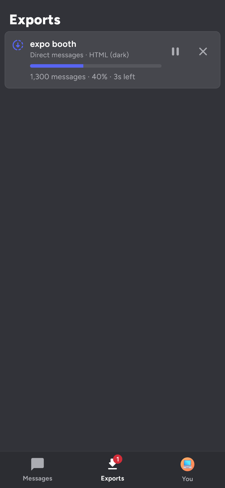

# Backscroll

Backscroll saves Discord conversations to files you can keep: HTML pages that look like Discord, or JSON, plain text and CSV. It runs on Windows, Linux and Android.

I wanted something like [DiscordChatExporter](https://github.com/Tyrrrz/DiscordChatExporter) that also works on my phone and doesn't lose attachments once Discord's file links expire. So Backscroll can save attachments next to the export, or upload them to a host of your own while it exports.

> [!WARNING]
> Automating a user account with its token is against Discord's Terms of Service. Use it at your own risk. Bot tokens don't have this problem.

## Download

Get the latest beta from the [releases page](https://github.com/Subsical/Backscroll/releases): a zip for Windows, a tarball for Linux and an APK for Android. The Windows app is signed with a self-signed certificate, so SmartScreen asks you to confirm the first time you run it.

## Features

- Works with DMs and group DMs through a user token, and with servers through a bot token
- Log in with Discord inside the app, or paste a token
- HTML (dark or light), JSON, plain text and CSV exports
- A whole conversation, a date range, only the pins, or everything from one message on
- Attachments kept as links, saved next to the export, or re-hosted on Catbox, ImgBB, S3 storage or a ShareX uploader
- Big channels split into parts, and exports that pick up where they stopped
- Search, pinned messages and jumping around a conversation before you export it
- Finished exports can be converted to another format without asking Discord again
- No server, account or tracking; tokens stay in your system's secure storage

## Screenshots

| HTML export, dark | HTML export, light |
| --- | --- |
|  |  |

  
  
  
  

The server, people and messages in these pictures are made up. They come from the sample server in [`test/screenshots`](test/screenshots), rendered by the real app and exporter.

## More

- [Logging in](docs/logging-in.md): the two kinds of token and how to get one
- [Exporting](docs/exporting.md): the options, what the files contain, converting and searching
- [Attachments](docs/attachments.md): the three ways to keep them and the hosts you can use
- [Building and releasing](docs/building.md): checking a download, building from source, tests and signing
- [Privacy policy](PRIVACY.md)

## Credits

- [DiscordChatExporter](https://github.com/Tyrrrz/DiscordChatExporter) by Oleksii Holub, MIT licensed. Backscroll is written from scratch, but how it pages through messages, renders Discord's markdown and lays out the HTML export closely follows DiscordChatExporter, and I learned a lot from reading it.
- [Twemoji](https://github.com/jdecked/twemoji) for emoji images, CC-BY 4.0.
- [highlight.js](https://highlightjs.org) for code blocks in HTML exports, BSD 3-Clause.
- [Figtree](https://github.com/erikdkennedy/figtree) by Erik Kennedy, SIL Open Font License.
- The sample pictures in the screenshots come from [Godot's demo projects](https://github.com/godotengine/godot-demo-projects), [Kenney's starter kits](https://github.com/KenneyNL) and [Fluent Emoji](https://github.com/microsoft/fluentui-emoji), all MIT licensed.

Backscroll isn't made by or affiliated with Discord.

## License

Backscroll is released under the [MIT License](LICENSE).
