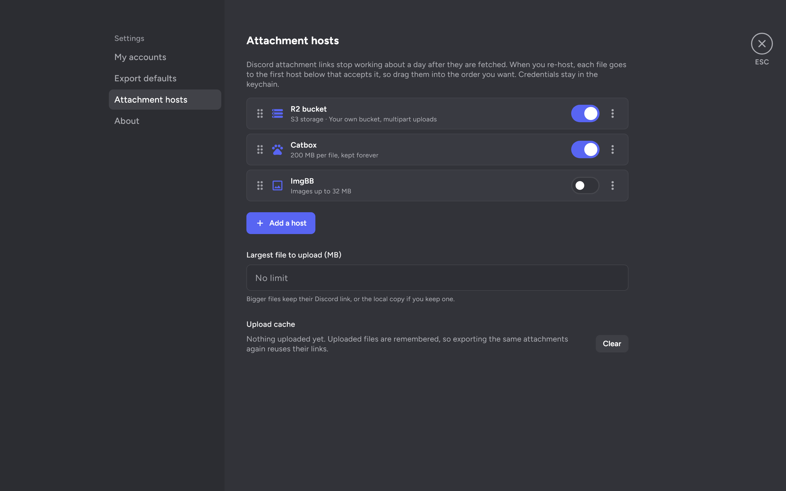

# Attachments

Discord's attachment links stop working about a day after they're fetched, so an export that only keeps the original links slowly loses its pictures. Each export can handle attachments in one of three ways:

1. **Keep Discord links.** Fastest, nothing is downloaded. This is the default until you set up a host.
2. **Save next to the export.** Every file goes into a `<export name>_files` folder beside the export. HTML exports also get local copies of avatars, emoji and icons, so nothing in them depends on Discord anymore.
3. **Re-host.** Attachments are uploaded to your hosts and the export links to the uploaded copies. Avatars and emoji keep their Discord links, which don't expire. Turn on **Also keep a local copy** to save the files as well; files that no host accepts then use the local copy instead of the Discord link.

Each attachment is downloaded right after its page of messages is fetched. Uploads run in the background with their own progress, while the export keeps fetching messages; a part's links are filled in once its uploads finish. Uploads are retried with backoff, and every uploaded file is remembered by attachment ID and by hash, so exporting the same channel again, or another channel with the same files, reuses the existing links.

## Hosts

Hosts are set up under **Settings → Attachment hosts**. Their keys and secrets go into the same secure storage as tokens. Each file goes to the first host in your list that accepts it, so you can put a host with strict limits first and a catch-all after it. There's also an overall size limit for uploads.

| Host | What you need | Limits |
| --- | --- | --- |
| [Catbox](https://catbox.moe) | Nothing. Add your userhash if you want the uploads tied to your account. | 200 MB per file. No `.exe`, `.scr`, `.cpl`, `.jar` or `.doc*` files, and GIFs up to 20 MB. Uploads run 2 at a time by default, at most 3. |
| [ImgBB](https://imgbb.com) | An API key from [api.imgbb.com](https://api.imgbb.com) | Images only, up to 32 MB each. |
| S3-compatible storage (AWS S3, Cloudflare R2, Backblaze B2, MinIO and others) | An https endpoint, bucket, region, access key, secret key and the public URL your files are served from | None of its own. Files over 32 MB go up as multipart uploads in 16 MB parts. 4 uploads at a time by default, up to 16. |
| ShareX custom uploader | A `.sxcu` file from the host | Whatever the host allows. You can set a size limit for it. |

Files on Catbox, ImgBB and most ShareX hosts are public: anyone with a link can open them. The app reminds you of that the first time you turn one on. With S3 storage, who can see the files depends on your bucket.
