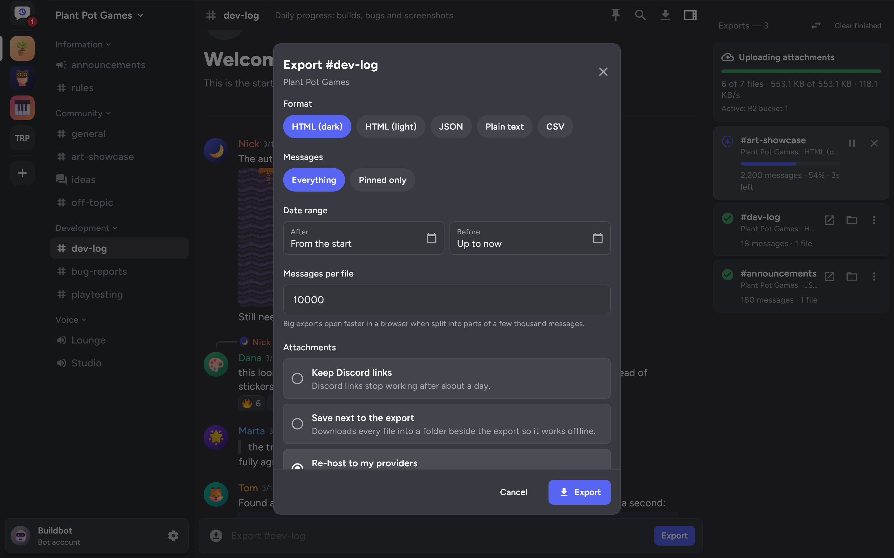
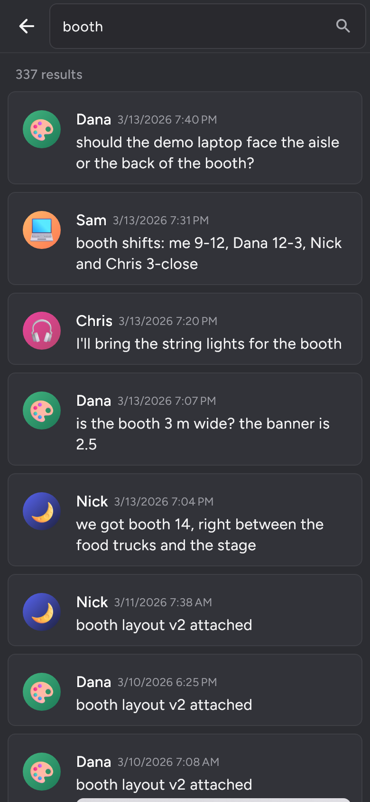

# Exporting

Pick a channel or DM and press **Export**, or select several and export them in one go. Each export has its own options:

- **Format:** HTML with the dark or light theme, JSON, plain text or CSV.
- **Messages:** everything, or only the pinned messages. A pins-only export reads the channel's pin list instead of its whole history, so it's quick even in a huge channel.
- **Date range:** everything, or only messages after and/or before a date.
- **Messages per file:** big channels are split into parts, 10,000 messages each by default. Leave it empty to keep everything in one file.
- **Threads:** forum posts and threads, including archived ones, are queued after their channel.

To export only part of a conversation, hover a message and use the buttons at its top right, or hold the message on a phone. **Export from here** starts at that message and **Export up to here** ends with it. Both open the export options with the range filled in. The same buttons copy the message's text, link or ID.

Exports go to `Downloads/Backscroll`. You can pick a different folder per export on desktop. The folder button on a finished export opens its folder in your file manager.

## What the files look like

Files are named after the server, category and channel, for example `Plant Pot Games - Development - dev-log [140000000000000010].html`, with ` [part 2]`, ` [part 3]` and so on for the following parts. A pins-only export has ` (pinned)` after the channel ID, so it doesn't replace a full export of the same channel.

The HTML export covers what you'd expect to see in Discord: grouped messages, avatars, role colours, replies, reactions, embeds, stickers, polls, threads, forwarded messages, system messages, mentions, timestamps and the full markdown set, including spoilers and code blocks. Bot messages laid out with Discord's components keep their cards, galleries, files, buttons and menus. The buttons and menus are shown but do nothing, except link buttons, which still open their link. The font is embedded in the file. Code highlighting loads highlight.js from a CDN, and emoji images come from the Twemoji CDN unless the export saves its media locally.

Pinned messages get a pin next to their time, and the pin button at the top of the page lists the ones in that file. The search button next to it finds text in the file and steps through the matches, which helps on a phone, where the export viewer has no find in page. The other formats mark pins too: `isPinned` in JSON, `(pinned)` in plain text and a `Pinned` column in CSV.

## While an export runs

Messages are fetched 100 at a time. Backscroll follows Discord's rate limit headers, waits out 429 responses and writes each page to disk before fetching the next one, so long channels don't pile up in memory. Progress and an estimate of the time left are shown per export.

If the app is closed or killed in the middle of an export, the export comes back paused the next time you open it. Resuming carries on from the last message that was saved instead of starting over. On Android a notification keeps the export running while the app is in the background.

## Converting an export

An export can be turned into another format later without asking Discord again, so it also works for conversations that are gone. In the exports list, open the **⋮** menu of a finished export and pick the format. On desktop, the button with the two arrows above the list converts any export file on your disk.

HTML and JSON exports can be converted, to any of the five formats. The new file is written next to the old one and uses the same saved or re-hosted attachments, so keep them in the same folder. Every part of a split export is converted together. Converting gives the same file an export in that format would have given.

Plain text and CSV files can't be converted, because they don't hold enough of the conversation. Neither can HTML pages exported with 1.0.0-beta.4 or older: those don't carry their data, so export the conversation again first.

## Searching and pins

  

The magnifier at the top of a conversation searches it with Discord's own search. Tap a result to jump to that spot. Older and newer messages load as you scroll from there, and **Jump to present** takes you back to the latest ones.

A user token searches each DM on its own. A bot searches the whole server and narrows the results down to the channel, which needs the **Message Content Intent**. When Discord hasn't indexed a conversation for search yet, the first search takes a few seconds while Backscroll waits and asks again.

The pin next to the magnifier lists the conversation's pinned messages. Tapping one jumps to it the same way.

The arrow above the list of conversations reloads the list, and so does F5.
