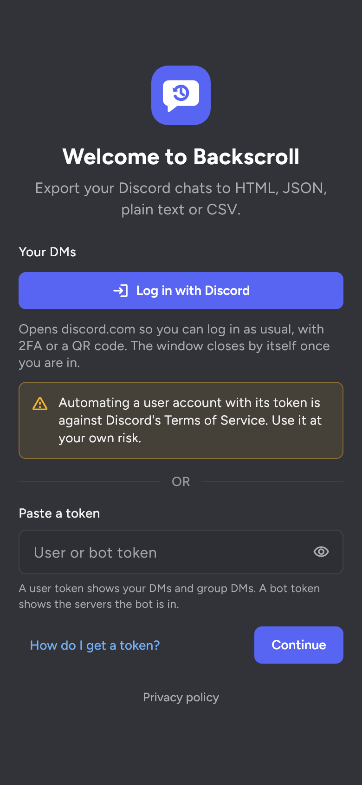

# Logging in

  

What you see depends on the kind of token:

- **User token:** your DMs and group DMs. Server channels are hidden in this mode.
- **Bot token:** the servers the bot is in and the channels it can read. No DMs.

> [!WARNING]
> Automating a user account with its token is against Discord's Terms of Service. Use it at your own risk. Bot tokens don't have this problem.

## Log in with Discord

Press **Log in with Discord** and a login page for discord.com opens inside the app (a separate window on desktop). Log in the way you normally would, with your password and 2FA or by scanning the QR code with the Discord app. As soon as you're in, Backscroll picks up the token, closes the page and wipes its cookies and storage.

It doesn't log out of that session, because logging out would kill the token it just picked up. To revoke the token later, end that session under User Settings → Devices in Discord, or change your password.

## Paste a token

You can also paste a token by hand. The app has the same steps under **How do I get a token?**

User token:

1. Open discord.com in a browser on a computer and log in.
2. Open the developer tools (Ctrl+Shift+I, or Cmd+Option+I on a Mac) and go to the Network tab.
3. Reload the page, type `api` into the filter box, click any request to `discord.com/api` and copy its `Authorization` header.
4. Close the tab instead of logging out. Logging out resets the token.

Bot token:

1. Open the [Discord Developer Portal](https://discord.com/developers/applications) and pick your application.
2. Under **Bot**, press **Reset Token** and copy it.
3. On the same page, turn on **Message Content Intent**. Without it, message text comes back empty.
4. Invite the bot to your server with the **View Channels** and **Read Message History** permissions.

## Where tokens are kept

Tokens go into the system's secure storage: the Secret Service (GNOME Keyring or KWallet) on Linux, the Android Keystore on Android, and DPAPI encryption tied to your Windows account on Windows. They are only ever sent to discord.com and never written to logs. Removing an account in the app only deletes its token from that storage.
